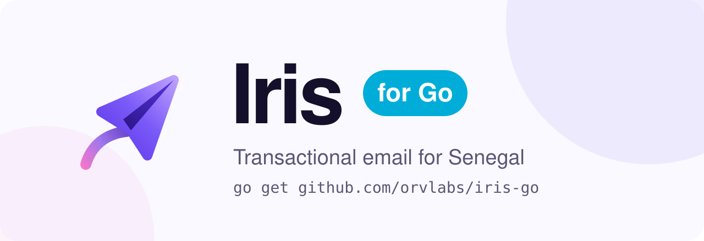

<p align="center">
  <a href="https://iris.orvlabs.com">
    <picture>
      <source media="(prefers-color-scheme: dark)" srcset=".github/banner-dark.svg">
      
    </picture>
  </a>
</p>

<p align="center">
  <a href="https://pkg.go.dev/github.com/orvlabs/iris-go"></a>
  <a href="https://github.com/orvlabs/iris-go/actions/workflows/test.yml"></a>
  <a href="https://github.com/orvlabs/iris-go/releases"></a>
  <a href="LICENSE"></a>
  
</p>

<p align="center">
  <a href="https://iris.orvlabs.com"><b>Website</b></a> ·
  <a href="https://iris.orvlabs.com/docs"><b>API reference</b></a> ·
  <a href="https://pkg.go.dev/github.com/orvlabs/iris-go"><b>Go docs</b></a>
</p>

---

Send receipts, codes and notifications from your Go server in a few lines, with **221 Pay** (Wave, Orange Money) payment links built in. One dependency, the official [Standard Webhooks](https://www.standardwebhooks.com) library, for verifying webhooks.

## Install

```sh
go get github.com/orvlabs/iris-go
```

Create a key in the [Iris console](https://iris.orvlabs.com) under **API keys**. Keep it on your server, never in a browser or mobile app.

## Send an email

```go
package main

import (
	"context"
	"log"
	"os"

	iris "github.com/orvlabs/iris-go"
)

func main() {
	client := iris.New(os.Getenv("IRIS_API_KEY"))

	sent, err := client.SendEmail(context.Background(), iris.Email{
		Sender:      iris.Address{Email: "commandes@boutique.sn", Name: "Boutique"},
		To:          []iris.Address{{Email: "awa@example.sn", Name: "Awa"}},
		Subject:     "Votre commande",
		HTMLContent: "<p>Merci {{params.prenom}} !</p>",
		Params:      map[string]any{"prenom": "Awa"},
	})
	if err != nil {
		log.Fatal(err)
	}
	log.Println("queued", sent.MessageID)
}
```

> [!TIP]
> Use a test key (`iris_test_…`) while you build. It is checked exactly like a real one, but nothing is delivered and no units are used.

## Ask for a payment

```go
sent, err := client.SendEmail(ctx, iris.Email{
	Sender:      iris.Address{Email: "factures@boutique.sn"},
	To:          []iris.Address{{Email: "awa@example.sn"}},
	Subject:     "Votre facture",
	HTMLContent: "<p>Votre facture est prête.</p>{{bloc_paiement}}",
	Payment: &iris.Payment{
		AmountXOF:   15000,
		Reference:   "FAC-2026-0042",
		Description: "Facture FAC-2026-0042",
		Methods:     []string{"wave", "orange_money"},
	},
})
```

The same reference and amount always reuse the same link. Link your 221 Pay merchant account in the console first.

## Handle errors

Every error from the API is an `*iris.Error` with the HTTP status and a stable `Code`.

```go
var apiErr *iris.Error
if errors.As(err, &apiErr) {
	switch {
	case apiErr.Code == "not_enough_credits":
		// top up in the console
	case apiErr.Retryable(): // 429, 502, 503
		// retry later, with an increasing delay
	default:
		log.Printf("iris refused: %s (%s)", apiErr.Code, apiErr.Message)
	}
}
```

> [!WARNING]
> Sending has no idempotency key: retrying after a network timeout can send the email twice.

## Verify a webhook

```go
http.HandleFunc("/webhooks/iris", func(w http.ResponseWriter, r *http.Request) {
	body, err := io.ReadAll(r.Body)
	if err != nil {
		http.Error(w, "unreadable body", http.StatusBadRequest)
		return
	}
	ev, err := iris.VerifyWebhook(os.Getenv("IRIS_WEBHOOK_SECRET"), r.Header, body) // whsec_…
	if err != nil {
		http.Error(w, "bad signature", http.StatusUnauthorized)
		return
	}
	// Deduplicate on ev.ID: a retry carries the same one.
	log.Println(ev.Type, ev.Data.Email) // email.delivered, email.bounced, email.opened…
	w.WriteHeader(http.StatusNoContent)
})
```

Read the raw body before parsing it: the signature covers the exact bytes.

## What's in the box

| | |
|---|---|
| `iris.New(key)` | Client for `https://iris.orvlabs.com`, 30 s timeout. Swap `BaseURL` or `HTTPClient` if you need to. |
| `client.SendEmail(ctx, email)` | Send now, or later with `ScheduledAt`. Templates, attachments, one-click unsubscribe, 221 Pay links. |
| `*iris.Error` | `Status`, `Code`, `Message`, `Retryable()`. |
| `iris.VerifyWebhook(secret, headers, body)` | Checks the signature and decodes the email event. |

Every route, field and error code is in the [API reference](https://iris.orvlabs.com/docs).

## License

[MIT](LICENSE), by [Orvene](https://orvlabs.com).
